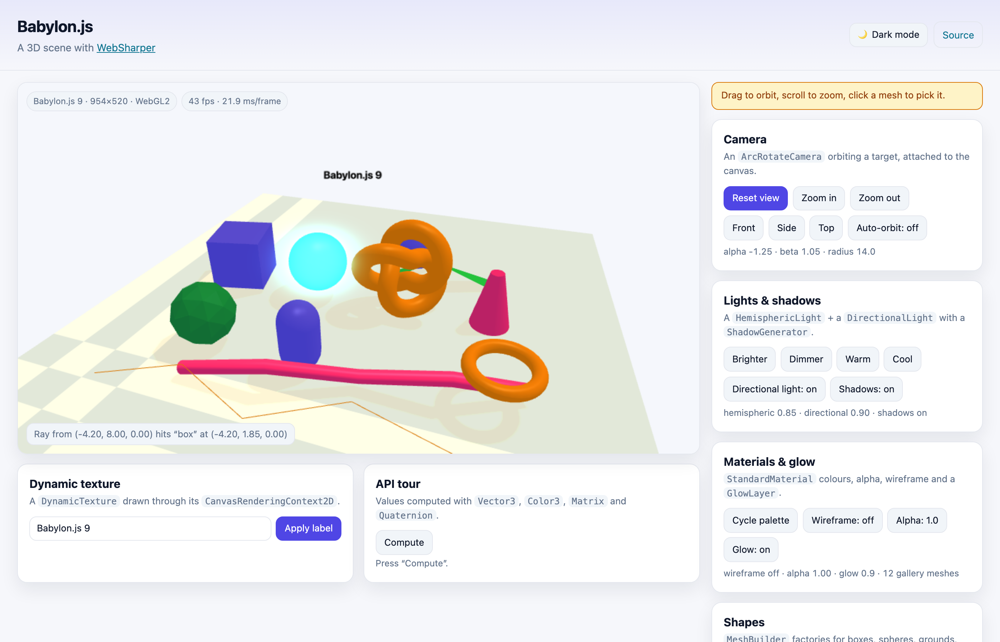

# WebSharper Babylon.js

A 3D playground built with [Babylon.js](https://www.babylonjs.com/) through the
[`WebSharper.BabylonJs`](https://github.com/dotnet-websharper/babylonjs) bindings
and compiled from F# to JavaScript with [WebSharper](https://websharper.com).

[](https://websharper-samples.github.io/BabylonJS/)

**[Try it live](https://websharper-samples.github.io/BabylonJS/)**

## What it shows

- An `Engine` with an `ArcRotateCamera` orbiting a target, and a
  `HemisphericLight` + `DirectionalLight` pair with a `ShadowGenerator`.
- A gallery of twelve `MeshBuilder` shapes — box, sphere, ground, cylinder,
  torus, torus knot, ico sphere, capsule, disc, tube, ribbon and a lathe.
- A `DynamicTexture` drawn through its `CanvasRenderingContext2D`.
- Pointer picking through `scene.onPointerObservable`.
- Live edits of materials, lights, the render loop and the scene lifecycle.
- A `Vector3`/`Color3`/`Matrix`/`Quaternion` tour in the “API tour” card.
- A light/dark theme switcher persisted in `localStorage`.

The F# source is `src/Client.fs`; the whole page is the template in
`src/index.html`, bound with `Template<...>` and `.Bind()`. All presentational
styling lives in `src/site.css`.

## Project structure

```
BabylonJS/
  src/
    Client.fs             # template binding, scene, UI state
    BabylonJS.fsproj
    index.html            # the page template
    site.css
    wsconfig.json
    package.json
    esbuild.config.mjs    # bundles @babylonjs/core + the WebSharper output
  docs/screenshot.png
  .github/workflows/deploy.yml
```

## Running locally

```
cd src
npm install
dotnet build -c Release
```

The Release build also runs esbuild and writes the static site to `dist/`.
Serve it with any static file server and open the URL:

```
cd dist
python3 -m http.server 8099 --bind 127.0.0.1
```

## Deployment

Every push to `main` builds in Release and publishes `dist/` to the `gh-pages`
branch.